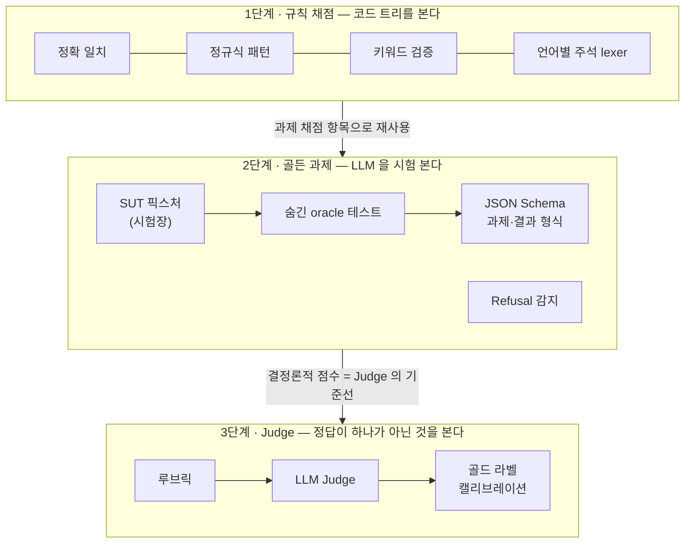
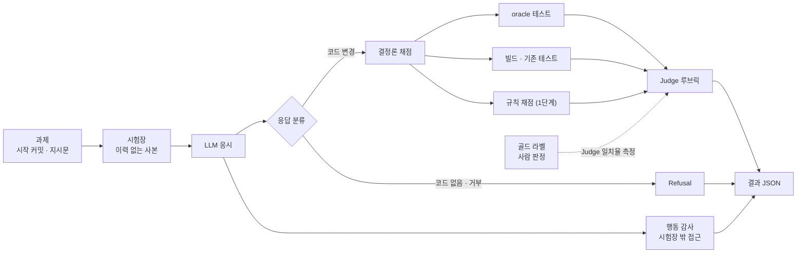

# 로드맵

LLM 이 낸 코드·답변이 올바른지 사람 대신 판정하는 채점기를 세 단계로 쌓는다.
아래 단계일수록 싸고 재현 가능하며, 위 단계는 아래 단계를 기준선으로 삼아 검증된다.

## 한눈에

## 채점 흐름 (2·3단계 완성 시)

## 키워드별 위치

| 키워드 | 단계 | 무엇을 판정하나 |
|---|---|---|
| 정확 일치 | 1 | 예외 등록 줄처럼 한 글자도 달라선 안 되는 대상 |
| 정규식 패턴 분석 | 1 | 금지 어노테이션·파일 짝 규칙 등 구조적 패턴 |
| 키워드 검증 | 1 → 2 | 1단계는 코드 안의 금지·허용 키워드, 2단계는 응답에 반드시 있어야 할 것 |
| SUT 픽스처 | 2 | 평가 대상(LLM)에게 매번 같은 조건을 주는 고정 시작점 |
| JSON Schema 기반 출력 평가 | 2 | 과제 정의와 채점 결과의 형식 고정, 구조화 응답 검증 |
| Refusal 감지 패턴 | 2 | 코드 없이 "할 수 없다"로 끝난 응답을 실패와 구분 |
| Judge 기반 루브릭 | 3 | 설계 품질·설명 정확성처럼 테스트로 못 가르는 것 |
| 골드 라벨 (캘리브레이션 셋) | 3 | Judge 점수가 사람 판정과 맞는지 재는 기준 |

## 단계별 설계 원칙

### 1단계 · 규칙 채점

- 변경분이 아니라 **트리 전체**를 본다. 변경분만 보면 기존 위반이 숨는다.
- 규칙을 지킬 수 없는 정당한 경우는 사유와 함께 예외로 등록하고, 더는 맞지 않는 예외는 보고한다.
- 컴파일러·포매터처럼 이미 있는 도구가 잡는 것은 여기 넣지 않는다. 프로젝트 고유 규칙만 맡는다.

### 2단계 · 골든 과제

- **과제는 실제로 틀렸던 일에서 고른다.** 회고·사고 기록에서 "빌드는 초록인데 결함이 있었던" 것이 우선이다. 채점기가 없으면 아무도 못 잡는 유형이기 때문이다.
- 과제 하나는 다섯 가지로 이루어진다: 시작 커밋 · 지시문 · 숨긴 oracle 테스트 · 참조 정답 · 채점 명령.
- **oracle 은 검증된 뒤에만 쓴다.** 알려진 오답(실제 결함 커밋)에서 실패하고 참조 정답에서 통과해야 한다. 고친 커밋에 테스트가 있다는 것이 그 테스트가 결함을 잡는다는 뜻은 아니다.
- oracle 은 **지시문이 준 계약만** 쓴다(진입점·API 필드·외부 의존). 내부 이름에 기대면 다른 올바른 설계를 떨어뜨린다.
- 지시문은 계약을 주되 정답의 힌트는 주지 않는다.
- 과제 하나에 함정 하나. 섞으면 실패 원인을 알 수 없다.
- 시험장에는 **이력이 없어야** 한다. 미래 커밋·고친 커밋 메시지가 남아 있으면 답을 읽을 수 있다. 완전한 격리가 어려우면 행동 기록을 감사한다.
- LLM 의 최종 보고("완료")와 실제 채점 결과를 함께 남긴다. 결함이 있는데 완료라고 한 경우가 가장 비싼 실패다.
- 과제는 소비 프로젝트(대개 비공개)에 두고, 이 저장소는 과제를 읽어 실행·채점하는 러너만 제공한다.

### 3단계 · Judge

- Judge 는 결정론 채점이 끝난 뒤, 테스트로 판정할 수 없는 항목만 본다.
- 루브릭은 항목별 기준과 점수 근거를 요구한다. 총점 하나만 받지 않는다.
- 골드 라벨(사람이 판정한 응답 묶음)로 Judge 와 사람의 일치율을 재고, 기준에 못 미치면 루브릭을 고친다. 일치율이 측정되지 않은 Judge 점수는 쓰지 않는다.
